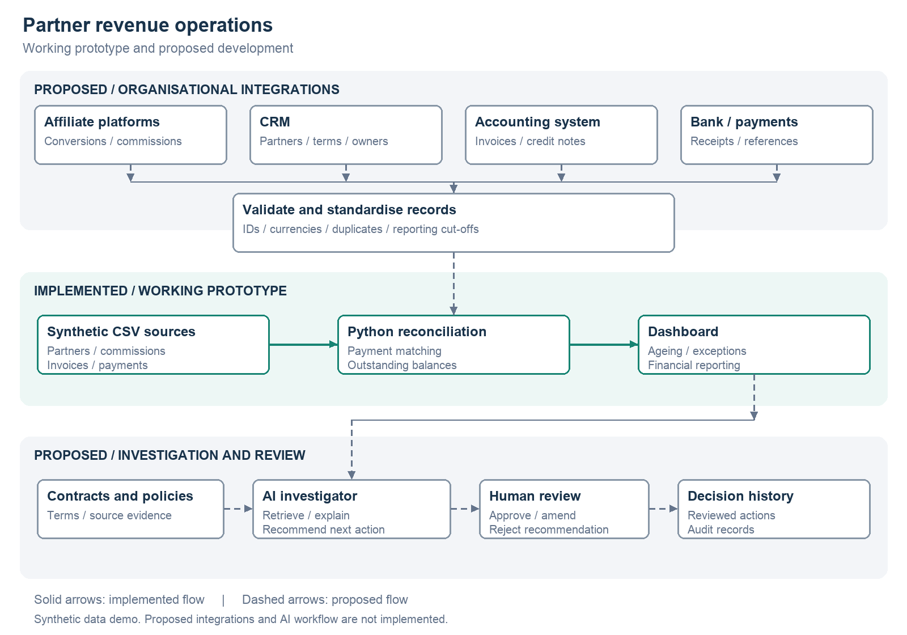
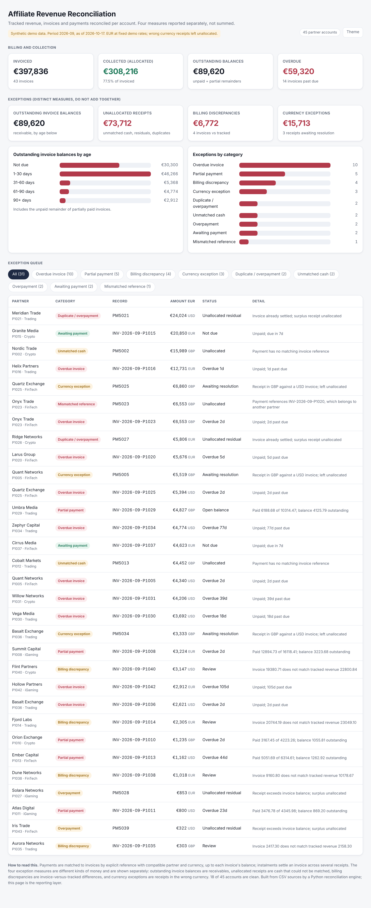

# Affiliate Revenue Reconciliation

A revenue operations tool that reconciles three sources of truth across affiliate partner accounts and reports where they disagree. Built as a demo of the reconciliation, exception-handling and reporting loop at the centre of a RevOps role.

All data in this project is synthetic test data generated with a fixed seed. No real partner or financial data is used.

## Architecture at a glance

A working reconciliation prototype with a proposed path to integrated, AI assisted revenue operations. The green section is implemented. Grey sections and dashed connections show planned extensions.





The diagram shows how it works; the screenshot shows what is built.

## What it does

For each partner it compares tracked revenue (commission earned, from the tracking and admin side), invoices (amounts billed), and payments (cash received). Payments are matched to invoices by explicit reference, with compatible partner and currency, up to each invoice's remaining balance. Several receipts can settle one invoice. A receipt that cannot be matched stays unallocated and is reported as such; nothing is auto-allocated across unrelated invoices.

## Reporting

The four exception measures are different kinds of money and are reported separately, never summed into one headline:

| Measure | Meaning |
|---|---|
| Outstanding invoice balances | Receivables: unpaid invoices plus the remainder of partially paid ones, with ageing |
| Unallocated receipts | Cash that could not be matched: unmatched payments, overpayment residuals, duplicates |
| Billing discrepancies | Invoice total differs from tracked revenue |
| Currency exceptions | Receipts in the wrong currency, left unallocated pending resolution |

## Exceptions detected

Overdue invoices, awaiting-payment invoices, partial payments, duplicate and overpayment residuals, unmatched cash, payments referencing another partner's invoice, billing discrepancies, and currency exceptions.

## How it is built

- `generate_and_reconcile.py` builds the synthetic sources, runs the reconciliation, writes the outputs, and rebuilds the dashboard in the same run.
- `build_dashboard.py` renders `index.html` from the computed summary. Both use paths relative to the script, so the project runs from any folder.
- `data/` holds the source CSVs and the reconciliation output (`exceptions.csv`, `summary.json`).
- `index.html` is the self-contained dashboard; no server or build step to view it.

## Run it

```
python3 generate_and_reconcile.py
```

One command regenerates the data, reruns the reconciliation, and rebuilds the dashboard. Then open `index.html` in any browser.

## Checks that hold on the demo data

- Collected plus outstanding equals invoiced, per the allocation logic.
- Instalments settling one invoice are matched, not flagged as duplicates.
- A payment referencing another partner's invoice is left unallocated, not marked paid.
- Ageing includes the unpaid remainder of partially paid invoices.

Money is normalised to EUR using fixed demo rates for comparison. Wrong-currency receipts are left unallocated rather than converted and matched, so their value is reported as a currency exception, not as a confirmed loss.

## Developing this into a full revenue operations system (design, not built)

A production revenue operation is more than reconciliation. It has to turn agreed commercial terms into correct invoices, collect against them, close each period for finance, and keep every number traceable to a source and an owner. The engine here covers detection and reporting. The controls below show how it would extend into that fuller operation. Each is written as the risk it addresses, the control, the evidence that control needs, who decides, and what to measure.

### Contract based commission validation

Different agreements calculate differently. CPA, revenue share and hybrid deals have their own rules, approval conditions, adjustments and effective dates, so tracking totals have to be checked against the agreed terms rather than trusted on their own.

- Risk: a partner's reported commission differs from what the contract entitles them to, or from the invoice.
- Control: hold each partner's commission terms with effective dates, and compare approved conversions for a billing period against the contract version in force for that period before the invoice is trusted.
- Evidence: conversion records, the applicable commission terms and adjustments, invoice lines.
- Decision: Revenue Operations investigates the difference; Finance approves any accounting adjustment.
- Measure: number of unresolved commission discrepancies and time to resolve them.

### Complete billing and collection workflow

Revenue operations runs the full cycle, not just the check at the end: invoice preparation, due date tracking, payment allocation, overdue follow up, dispute handling and ownership of every unresolved case.

- Risk: invoices go out late, payments are not chased, and disputes have no owner, so cash slips and the receivable ages.
- Control: a workflow covering preparation, due date tracking, allocation, overdue follow up, dispute handling and an explicit owner for each open case through to closure.
- Evidence: invoices with due dates, allocations, follow up history, dispute notes.
- Decision: Revenue Operations owns follow up and allocation; a lead approves write offs and dispute settlements.
- Measure: days sales outstanding, overdue balance by age, share of invoices paid on terms.

### Monthly close support

Finance needs period cut offs, reconciled balances, explanations for differences and a documented list of what remains open.

- Risk: the period is closed on numbers that are not reconciled, and differences surface after the books are closed.
- Control: period cut offs, a reconciled balance per partner at close, a documented explanation for each difference, and a list of items carried forward.
- Evidence: period boundaries, reconciled balances, difference explanations, carry forward log.
- Decision: Revenue Operations prepares the close pack; Finance signs off.
- Measure: time to close, number of post close adjustments, value of unexplained differences at close.

### Accounting policy controls

Tracked commission, invoiced amount, cash received and recognised revenue mean different things. Treatment depends on the contract and the applicable accounting framework.

- Risk: the four measures are treated as the same thing and revenue is recognised incorrectly.
- Control: keep the four measures distinct in the data model and apply recognition rules drawn from the contract and the accounting framework, rather than treating tracked commission as recognised revenue.
- Evidence: the four measures per partner and period, the contract terms, and the recognition rule applied.
- Decision: Finance owns the recognition policy; Revenue Operations applies and evidences it.
- Measure: number of records where recognition would differ from cash or tracking, and the value affected.

### Data ownership and traceability

Reliable reporting needs source IDs, validation rules, update schedules, accountable owners and a history of changes.

- Risk: reporting cannot be trusted because numbers do not trace to a source, validation is undocumented, and no one owns a given record.
- Control: preserve source IDs and import batches, document validation rules and refresh schedules, assign an owner per data domain, and keep a change history.
- Evidence: source IDs, import batch records, validation logs, ownership register, change history.
- Decision: each data owner approves changes to their domain; quarantined or changed records are reviewed, not overwritten silently.
- Measure: share of reported figures traceable to source, rejected row counts, data freshness by source.

### AI assisted investigation

An agent can retrieve records and policy, suggest explanations and draft follow ups, always with evidence and human approval.

- Risk: analysts rebuild the context of each exception by hand and explanations come out inconsistent.
- Control: a read only agent that retrieves the records and policy for one exception, separates established facts from possible explanations, flags missing evidence and drafts a follow up. Amounts come from calculation tools, not the model. It cannot change records, move money or approve its own recommendation.
- Evidence: the records and policy it retrieved, with source IDs; its stated facts, hypotheses and gaps.
- Decision: Revenue Operations accepts, amends or rejects the recommendation; Finance approves any accounting effect.
- Measure: evidence ID validity, agreement between the agent's figures and the calculation tools, rate of unsupported assertions, time saved per investigation.

### Planned integrations and data sources

In daily operation the reconciliation model is only as reliable as the records feeding it, so the system would connect to the operational sources rather than depend on manual exports. The main connections:

| Source | Data needed |
| --- | --- |
| Affiliate platforms | Conversions, approved commissions, adjustments and payment statements |
| CRM | Partner accounts, contacts, commercial terms and responsible owners |
| Accounting and invoicing system | Invoices, credit notes, due dates and recorded balances |
| Bank or payment provider | Receipts, transaction references, fees and currencies |

Making those records comparable is the real work: consistent partner and invoice IDs, field mapping into the common model, currency handling, duplicate prevention and reporting cut offs. Scheduled imports or webhooks would carry validation, failure alerts and retry handling. Initial connections would be read only; any write back would require explicit approval and an audit trail.

Planned integrations: connect affiliate platforms, CRM, invoicing systems and bank or payment provider records through APIs or scheduled file imports. Map source records into a common reconciliation model, with validation, duplicate prevention, synchronisation monitoring and traceability to the original transaction. Begin with read only connections and introduce approved write back workflows where appropriate.

### Policy database

A policy database ties this together. Each exception links to the contract term, internal procedure or accounting guidance that governs it, with applicability, effective dates, source and a review owner. That is what keeps decisions consistent and traceable rather than handled case by case, and it is what the AI investigator reads from, so its explanations rest on recorded policy rather than inference.

The implemented dashboard is the concrete starting point. These controls show how the same engine would grow into the fuller role, each one carrying its own rules and tests.
