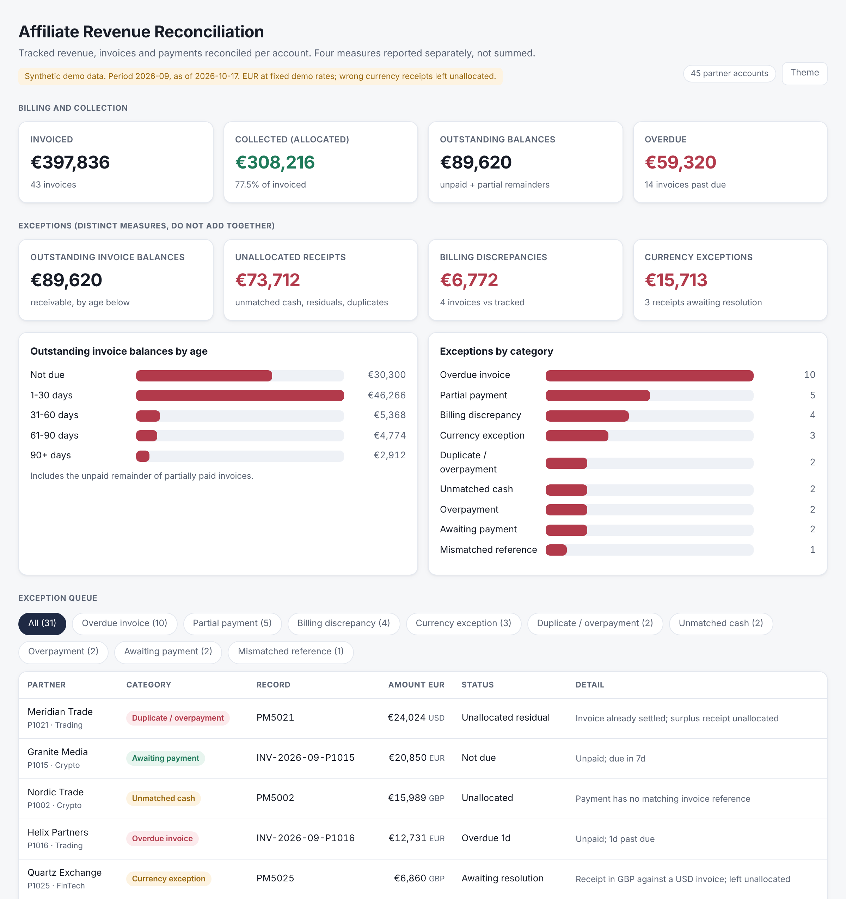

# Affiliate Revenue Reconciliation

A working Python reconciliation prototype and dashboard for comparing partner commissions, invoices and incoming payments. It identifies outstanding balances and payment exceptions using synthetic data. The proposed design explains how this core could support a wider revenue operations workflow.



## Run the demo

Use Python 3.9 or later. The scripts use the Python standard library; no package installation or API key is required. Extract or clone the complete project, then run these commands from its root folder:

```bash
python3 generate_and_reconcile.py
python3 verify_demo.py
```

Open **index.html** in a browser. It is self-contained and needs no web server. The first command regenerates the synthetic data and dashboard; it does not import your own financial records. The reporting date is fixed at **17 October 2026**.

## What is generated

| File | Purpose |
| --- | --- |
| `index.html` | Interactive dashboard with balances, ageing and a filterable exception table |
| `data/summary.json` | Calculated metrics and exception records used by the dashboard |
| `data/exceptions.csv` | Record-level exception report for inspection or spreadsheet use |
| `data/partners.csv` | Synthetic partner account details |
| `data/tracked_revenue.csv` | Synthetic tracking-system commission totals |
| `data/invoices.csv` | Synthetic invoice records and due dates |
| `data/payments.csv` | Synthetic receipts and invoice references |

## Reconciliation rules

- Match payments by invoice reference, partner and currency, capped at the remaining invoice balance.
- Support instalments and retain overpayments or unmatched receipts as unallocated cash.
- Report outstanding invoice balances, including partial remainders, with ageing.
- Flag billing differences, currency exceptions and mismatched references.
- Filter and sort exceptions in the dashboard; generate JSON and CSV reporting outputs.

Outstanding balances, unallocated receipts and billing differences are separate measures. **Currency-exception receipts are a subset of unallocated receipts.** These figures must not be summed as a single loss or exposure total. Tracked commissions, invoices and cash receipts do not by themselves establish recognised accounting revenue.

## Checks and limitations

`python3 verify_demo.py` checks exception counts, ageing totals, account counts and agreement between the dashboard and summary. It also reports the EUR reconciliation difference. These are executable output-consistency checks, not exhaustive reconciliation-rule tests or an accounting-compliance assessment.

Known limitations:

- Synthetic data only, with fixed illustrative EUR conversion rates; no live connections or accounting entries.
- The supplied output has a **€0.01** EUR rounding difference between invoiced amounts and allocated receipts plus outstanding balances.
- Some synthetic invoice issue dates precede their labelled billing period; the fixture dates need correction before being used as a realistic period-close example.
- The engine generates its own fixtures; it does not yet validate arbitrary uploaded datasets or maintain a persistent allocation ledger.
- Payments are not allocated across unrelated invoices; wrong-currency receipts remain unresolved.
- The exception table shows converted EUR amounts beside original currency codes; separate native and converted amount fields are a planned display correction.
- Recommended actions, source-record drill-down and human review are proposed, not implemented.

The earlier payment-matching review covered equal instalments, wrong references, partial payments and surplus receipts. Those checks are not yet packaged as a full automated regression suite. The fixed seed does not guarantee byte-identical files across processes because one generated reference is selected from an unordered set.

## Implementation details

The project uses standard-library Python for fixture generation, invoice-level payment allocation and reporting. `build_dashboard.py` embeds the computed summary in a standalone HTML page. Filtering and sorting run locally in the browser. There is no application server or database in the implemented prototype.


## Future roadmap

| Area | Intended next step — not implemented |
| --- | --- |
| Source integrations | Read-only feeds from affiliate platforms, CRM, accounting systems and banks; validate mappings, duplicates, freshness and failed imports |
| Commission controls | Check approved conversions against effective contract terms and adjustments |
| Collections and close | Assign case owners, recommend follow-ups, document disputes and prepare reconciled period-end information for Finance |
| AI investigator | Retrieve evidence and applicable policies, suggest explanations and draft next actions for human review |
| Policy and audit records | Version contract and policy references; preserve reviewed decisions and approval history |

Green shows the implemented prototype; grey sections show proposed extensions. The AI agent, live integrations, case lifecycle and approval history are design proposals. See [the detailed operational design](docs/DESIGN.md) for risks, controls, evidence, responsibilities and proposed measures.

